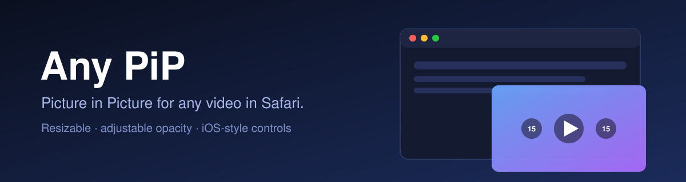
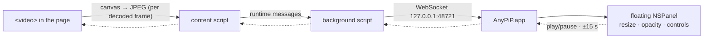

<p align="center">
  
</p>

<p align="center">
  
  
  
  
</p>

**Any PiP** is a Safari extension that pops *any* video out into Picture in Picture — with a choice of two modes:

| | **Apple PiP** | **Free PiP** |
|---|---|---|
| Window | System PiP window | Own floating window |
| Resize | System limits | **Any size**, keeps the video's aspect ratio, no black bars |
| Opacity | Fixed | **Adjustable** (slider or ⌥-scroll) |
| Controls | System | **Translucent iOS-style**: play/pause, ±15 s |
| On-page video | Stays | Hidden while PiP is open, restored (and paused) on close |
| Click-through | — | **Lock** mode: clicks pass through to what's underneath |
| Crop | — | **Crop** mode: window edges cut the video instead of scaling it |

## Features

- **One button, one hotkey** — toolbar button or **⌥⇧P**; press again to close.
- **Picks the right video** — the biggest *playing* video on the page, including inside iframes and shadow DOM.
- **Works where native PiP is blocked** — strips `disablepictureinpicture` on sites that hide it.
- **Always on top, on every Space** — the Free PiP window floats above full-screen apps too.
- **Remembers** window size/position, opacity and mode.
- **Lock (click-through)** — 🔒 in the top-right corner makes the window ignore the mouse; a small lock badge (or the menu bar, ⌘L) unlocks it.
- **Crop** — resize the window to show just part of the video (e.g. the square content of a wide video): edges cut, drag pans, wheel/pinch zooms, ⌘-drag moves the window. Press crop again to finish: the window keeps showing that part and resizes normally. Resets on each new PiP.
- **Menu bar icon** for switching modes and opening Settings (Safari's own right-click menu can't be extended).
- **Auto-starts the app** — the extension launches the companion app in the background when needed.

## How Free PiP works

Safari's native PiP window can't be resized freely or made transparent, and Safari has no Document PiP API. So Free PiP renders the video itself:



Audio keeps playing from the original tab. Commands from the window's buttons travel back the same way.

**Limits:** ~100–300 ms of latency; DRM video (Netflix & co.) and cross-origin video that can't be read into a canvas fall back to Apple PiP.

## Install

Requires macOS with Safari, Xcode, and an Apple developer team for signing. The project ships with the placeholder `YOUR_TEAM_ID`; `install.sh` overrides it with your team ID (find it at developer.apple.com → Membership), taken from the `DEVELOPMENT_TEAM` env var or an untracked `.team` file.
The bundle ID is a placeholder too (`com.example.anypip`); set your own with the `ANYPIP_BUNDLE_ID` env var or an untracked `.bundle` file (the extension becomes `<id>.Extension`). It must be unique to your team.

```sh
git clone https://github.com/VForced/safari-extension-pip.git
cd safari-extension-pip
DEVELOPMENT_TEAM=ABCDE12345 ./install.sh   # or: echo ABCDE12345 > .team && ./install.sh
                  # builds, installs to ~/Applications/AnyPiP.app, launches it
```

Then in Safari: **Settings → Extensions → Any PiP** → enable and allow all websites.
Unsigned/ad-hoc builds additionally need *Develop → Allow Unsigned Extensions*.

## Usage

1. Play a video, click the toolbar button (or press **⌥⇧P**).
2. Hover the Free PiP window to reveal the controls; drag any edge to resize; **⌥-scroll** or the slider changes opacity.
   Top-right buttons: **crop** and **lock**.
3. Switch mode from the menu bar icon (or the app's Settings window).

## Project layout

```
AnyPiP/
├── AnyPiP/                 macOS app: floating panel, WebSocket server, settings, menu bar
└── AnyPiP Extension/       Safari Web Extension (MV3): content + background scripts, native launcher
install.sh                  build → install → launch
```

## Notes

- The local WebSocket only listens on `127.0.0.1`.
- Built and tested with Xcode 27 on macOS 27; contributions and issues welcome.

## License

[MIT](LICENSE)
